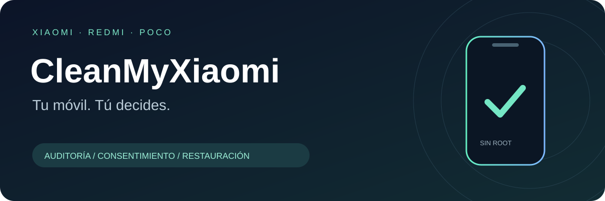

<p align="center"></p>

<h1 align="center">CleanMyXiaomi</h1>
<p align="center"><strong>Your phone. Your choices.</strong><br>AI-guided Xiaomi · Redmi · POCO auditing and reversible cleanup.</p>
<p align="center"><a href="README.md">Español</a> · <a href="PROMPT.md">Start with an AI agent</a> · <a href="docs/SAFETY.md">Safety model</a> · <a href="docs/RECOVERY.md">Restore</a></p>

**Status: early alpha. Audit is available; no real-device package cleanup profiles are approved yet.** The cleanup and restore engine is implemented and tested with synthetic devices. The three included profiles authorize **zero package changes**. This is a deliberate safety boundary, not a claim that every Xiaomi is safe to debloat.

## Step-by-step quick start

1. Download **Code → Download ZIP** from the repository and extract it. Open a terminal in the folder containing `README.md` and `cleanmyxiaomi/`.
2. Check Python 3.10+ with `python3 --version` (Windows: `py -3 --version`).
3. Enable USB debugging on your own phone, connect a USB data cable, unlock the screen and authorize only your trusted computer. Do not enable OEM unlocking.
4. For agent guidance, paste the prompt below; it does not authorize any package changes. For manual use, continue with the commands in this README.
5. Run `doctor`. If ADB is missing, get Platform Tools from Google, extract it, and add its folder to PATH or pass the global `--adb` path on every command.
6. Run `devices`, identify your actual serial and require state `device`. Run `detect` with that serial and verify the model/build. Never choose the first device automatically.
7. Save an `audit`, list `profiles`, create a `plan` and inspect it with `dry-run`. Replace `YOUR_USB_SERIAL` in every example. Output filenames must be new.
8. **`actions: []` is the expected result with all shipped profiles. Stop after auditing; do not run cleanup or invent a package list.** Keep the reports private. Disable USB debugging and revoke authorization when finished.

`No module named cleanmyxiaomi` means you should check the terminal folder; `unauthorized` means the phone has not authorized the computer; `offline` means you must resolve the connection first. The audit changes no packages and needs no restore. The CLI returns technical English JSON; the agent explains it in your language. A comprehensive beginner walkthrough and result table are in the [Spanish main README](README.md).

## Start with one prompt

Download this repository, open its folder in your coding agent, and paste:

> Read PROMPT.md and follow its workflow. Help me audit my Xiaomi, Redmi or POCO. Speak in my language. Identify the exact connected phone and explain the plan before changing anything.

The agent asks for your model, helps you enable USB debugging, discovers ADB, inspects the actual phone and produces an auditable plan. It must reply in **whichever language you use**, switching when you do. Commands and package names remain unchanged.

**No root. No uninstall. No silent changes.** Unknown packages and untested builds stay untouched. The project does not promise to remove every ad. Personalization settings and the amount of advertising are different things; see the [manual advertising guide](docs/ADS.md).

## What works today

| Capability | Status |
| --- | --- |
| ADB discovery and official installation guidance | Implemented; installation remains user-approved |
| Explicit USB device selection and exact firmware inventory | Implemented; unknown output stops the workflow |
| Package inventory, saved audit and dry-run plan | Implemented |
| Reviewed profile registry with content hashes | Three audit-only profiles; zero hardware cleanup approvals |
| `disable-user --user 0` with write-ahead journal | Implemented; available only for future reviewed, matching profiles |
| Restore to original default or explicitly enabled state | Implemented; separately approved and verified |
| Automated tests | Synthetic boundary and recovery tests; not hardware certification |
| System settings/UI automation, root, uninstall, flashing | Not implemented or permitted |

## Run without installing a Python package

Requirements: Python 3.10+, trusted Android SDK Platform Tools, a USB data cable, an owner-controlled Xiaomi/Redmi/POCO running MIUI/HyperOS on Android 8+, owner user 0, and an ordinary non-root ADB shell. macOS, Windows and Linux workflows are provided; this release was locally tested on macOS with Python 3.14. The CI matrix checks the other environments.

On Windows use `py -3` instead of `python3` if needed. Run from the repository root:

```sh
python3 -m cleanmyxiaomi doctor
python3 -m cleanmyxiaomi devices
python3 -m cleanmyxiaomi --serial YOUR_USB_SERIAL detect
python3 -m cleanmyxiaomi --serial YOUR_USB_SERIAL audit --out sessions/phone.audit.json
python3 -m cleanmyxiaomi profiles
python3 -m cleanmyxiaomi --serial YOUR_USB_SERIAL plan --profile xiaomi-audit --out sessions/phone.plan.json
python3 -m cleanmyxiaomi dry-run --plan sessions/phone.plan.json
```

Global `--serial` and optional `--adb /absolute/path/to/adb` go **before** the command. `redmi-audit` and `poco-audit` are equivalent audit-only choices. Files are never overwritten; use a new filename for a new session. [Full setup instructions](docs/SETUP.md).

## Cleanup and restore

With the shipped audit-only profiles the plan is empty. Do not invent a package list to bypass this. A future cleanup profile must be reviewed, tested on the exact model/build/region and package versions, and added through the [profile review process](docs/PROFILES.md).

For a supported future profile, review the complete plan, side effects, exact serial and model. Only after the user explicitly approves those changes:

```sh
python3 -m cleanmyxiaomi --serial YOUR_USB_SERIAL cleanup --plan sessions/phone.plan.json --journal sessions/cleanup.journal.jsonl --approve FULL_PLAN_SHA256 --confirm-device YOUR_USB_SERIAL
```

Preview recovery, then approve its **own** SHA-256:

```sh
python3 -m cleanmyxiaomi --serial YOUR_USB_SERIAL restore --journal sessions/cleanup.journal.jsonl --out sessions/restore.plan.json
python3 -m cleanmyxiaomi --serial YOUR_USB_SERIAL restore --journal sessions/cleanup.journal.jsonl --apply --approve FULL_RESTORE_SHA256 --confirm-device YOUR_USB_SERIAL
```

`restore` is read-only unless `--apply` is present. It restores only attempted changes recorded by this project, in reverse order. It does not enable every disabled app. Preserve the journal and original project version. See [recovery limitations](docs/RECOVERY.md) before relying on rollback.

## Understand the boundaries

- A saved inventory is **not a backup of your photos, files or app data**. Make a normal personal backup first.
- Disabling a package can affect dependencies, notifications and vendor features even if the command is reversible. Hardware validation remains essential.
- Plans expire after 24 hours and are rejected after device, firmware, inventory or target-state drift. Restore also refuses a changed build or target version.
- Multiple phones are allowed only with an explicit serial. Wi-Fi ADB, emulators and secondary users are unsupported.
- Local hashes detect corruption and bind approval to content; they do not authenticate maliciously edited source or files. Use a trusted checkout.
- Reports contain identifiers and app inventories. Keep `sessions/` private. The CLI has no telemetry or cloud API; your chosen AI agent may process any data you share with it.
- After a change, manually check calls, SMS, Wi-Fi, mobile data, camera, notifications, account access and updates. Reboot only when you choose. Disable USB debugging and revoke its authorizations when finished.

## Develop and contribute

```sh
python3 -m unittest discover -s tests -v
python3 scripts/check_repository.py
python3 scripts/build_release.py
```

Runtime uses the Python standard library. Optional packaging: `python3 -m pip install .` in a virtual environment. See [CONTRIBUTING.md](CONTRIBUTING.md), [SECURITY.md](SECURITY.md), [architecture](docs/ARCHITECTURE.md) and [release checklist](docs/RELEASING.md).


