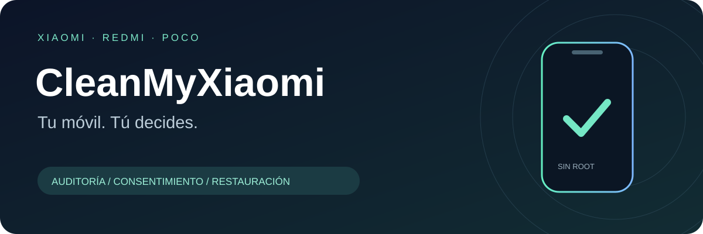

<p align="center"></p>

<h1 align="center">CleanMyXiaomi</h1>
<p align="center"><strong>Tu móvil. Tú decides.</strong><br>Auditoría y limpieza reversible de Xiaomi · Redmi · POCO con ayuda de un agente de IA.</p>
<p align="center"><a href="README.md">English</a> · <a href="PROMPT.md">Empezar con un agente</a> · <a href="docs/SAFETY.md">Seguridad</a> · <a href="docs/RECOVERY.md">Restauración</a></p>

**Estado: versión alfa inicial. La auditoría está disponible; todavía no hay perfiles de limpieza aprobados en teléfonos reales.** El motor de limpieza y restauración está implementado y probado con dispositivos simulados. Los tres perfiles incluidos autorizan **cero cambios de paquetes**. No presentamos una lista genérica como si fuera segura para todos los Xiaomi.

## Empieza con un prompt

Descarga el repositorio, abre su carpeta en tu agente de programación y pega:

> Lee PROMPT.md y sigue su procedimiento. Ayúdame a auditar mi Xiaomi, Redmi o POCO. Respóndeme en mi idioma. Identifica el teléfono conectado y explícame el plan antes de cambiar nada.

El agente pregunta el modelo, ayuda con la depuración USB, localiza ADB, comprueba el dispositivo real y prepara un plan revisable. Debe hablar en **el idioma que utilices**, y cambiar cuando tú cambies. Los comandos y nombres de paquetes se conservan.

**Sin root. Sin desinstalaciones. Sin cambios silenciosos.** Los paquetes desconocidos y las versiones sin verificar se dejan intactos. No se garantiza eliminar todos los anuncios. Desactivar la personalización no equivale a eliminar publicidad: consulta la [guía de ajustes](docs/ADS.md).

## Qué incluye

| Función | Estado |
| --- | --- |
| Localizar ADB y orientar su instalación oficial | Implementado; la instalación requiere autorización |
| Elegir el dispositivo USB y detectar su firmware exacto | Implementado; se detiene ante datos desconocidos |
| Inventario, auditoría guardada y simulación | Implementado |
| Registro de perfiles revisados con huellas de contenido | Tres perfiles de auditoría; ninguno de limpieza real |
| Desactivación por usuario con registro previo | Motor implementado para futuros perfiles compatibles y revisados |
| Restauración del estado original | Implementada, con aprobación independiente |
| Pruebas automáticas | Simuladas; no certifican compatibilidad real |
| Root, desinstalación, flasheo y automatización de ajustes | Fuera del alcance |

## Uso directo

Necesitas Python 3.10+, Android SDK Platform Tools de confianza, un cable USB de datos y un Xiaomi/Redmi/POCO propio con MIUI/HyperOS, Android 8 o posterior, usuario principal 0 y ADB sin root. Hay instrucciones para Windows, macOS y Linux. La comprobación local se hizo en macOS con Python 3.14; los demás entornos están incluidos en la matriz de CI.

En Windows puedes sustituir `python3` por `py -3`. Desde la carpeta del repositorio:

```sh
python3 -m cleanmyxiaomi doctor
python3 -m cleanmyxiaomi devices
python3 -m cleanmyxiaomi --serial TU_SERIAL_USB detect
python3 -m cleanmyxiaomi --serial TU_SERIAL_USB audit --out sessions/telefono.audit.json
python3 -m cleanmyxiaomi profiles
python3 -m cleanmyxiaomi --serial TU_SERIAL_USB plan --profile xiaomi-audit --out sessions/telefono.plan.json
python3 -m cleanmyxiaomi dry-run --plan sessions/telefono.plan.json
```

`--serial` y `--adb /ruta/absoluta/adb` van **antes** del comando. También existen `redmi-audit` y `poco-audit`, con el mismo alcance de solo lectura. No se sobrescriben archivos: usa nombres nuevos en cada sesión. [Instalación y conexión](docs/SETUP.md).

## Limpieza y restauración

Los perfiles incluidos generan un plan vacío. No inventes una lista de paquetes para saltarte esta limitación. Un futuro perfil de limpieza debe probarse en el modelo, firmware, región y versiones de aplicaciones exactos, y pasar la [revisión de perfiles](docs/PROFILES.md).

Cuando exista un perfil compatible, revisa los paquetes, efectos secundarios, modelo y número de serie. Solo después de aprobar expresamente ese plan:

```sh
python3 -m cleanmyxiaomi --serial TU_SERIAL_USB cleanup --plan sessions/telefono.plan.json --journal sessions/limpieza.journal.jsonl --approve SHA256_COMPLETO_DEL_PLAN --confirm-device TU_SERIAL_USB
```

Para restaurar, primero consulta el plan y aprueba su **propia** huella:

```sh
python3 -m cleanmyxiaomi --serial TU_SERIAL_USB restore --journal sessions/limpieza.journal.jsonl --out sessions/restauracion.plan.json
python3 -m cleanmyxiaomi --serial TU_SERIAL_USB restore --journal sessions/limpieza.journal.jsonl --apply --approve SHA256_COMPLETO_DE_RESTAURACION --confirm-device TU_SERIAL_USB
```

Sin `--apply`, la restauración no cambia nada. Solo revierte las operaciones intentadas y registradas por el proyecto, en orden inverso. Conserva el registro y la versión original del proyecto. [Recuperación y límites](docs/RECOVERY.md).

## Límites importantes

- El inventario **no es una copia de tus fotos, archivos ni datos de aplicaciones**. Haz antes tu copia habitual.
- Desactivar un paquete puede afectar funciones y dependencias, aunque el cambio de estado sea reversible. Hace falta validación real.
- El plan caduca a las 24 horas. Cambiar el teléfono, firmware, inventario o estado de un objetivo exige revisarlo de nuevo. Una actualización también puede bloquear la restauración automática.
- Siempre se exige un número de serie explícito. No se admite ADB por Wi-Fi, emuladores ni usuarios secundarios.
- Las huellas detectan corrupción y vinculan la aprobación al contenido; no protegen frente a un código fuente modificado maliciosamente.
- Los informes contienen identificadores y aplicaciones instaladas. Mantén `sessions/` privado. La herramienta no envía telemetría; tu agente de IA puede procesar lo que compartas con él.
- Tras cualquier cambio, comprueba llamadas, SMS, Wi-Fi, datos móviles, cámara, notificaciones, cuentas y actualizaciones. Reinicia cuando tú decidas. Al terminar, desactiva la depuración USB y revoca sus autorizaciones si ya no la necesitas.

## Contribuir

```sh
python3 -m unittest discover -s tests -v
python3 scripts/check_repository.py
python3 scripts/build_release.py
```

Sin dependencias externas durante la ejecución. Instalación opcional en un entorno virtual: `python3 -m pip install .`. Consulta [CONTRIBUTING.md](CONTRIBUTING.md), [SECURITY.md](SECURITY.md) y la [arquitectura](docs/ARCHITECTURE.md).

Inspirado en el flujo con agentes de [CleanYourTV](https://github.com/Gathin23/cleanyourtv), con implementación independiente y sin copiar código ni perfiles. Sin afiliación con Xiaomi, Redmi, POCO, Google ni proveedores de IA. Código, documentación y SVG originales bajo [licencia MIT](LICENSE). ADB conserva su propia licencia.
